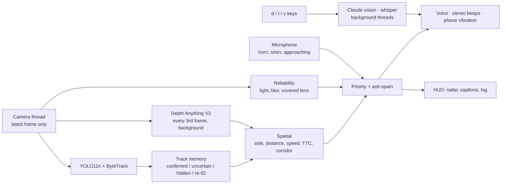

# Occhio — the eyes that talk

**Real-time assistive vision: a camera that tells blind people, by voice, only what matters around them,
and the same engine keeps factory and hangar workers safe.**
The Big Hack 2026 · Mare Group FieldVision challenge.

 <!-- placeholder: record with --record, convert to a GIF -->

## The problem

A white cane senses about 1 metre ahead, at ground level. It cannot warn about a bike coming fast,
a person walking toward you, a car backing out, or a horn behind you.

## What Occhio does

A webcam or iPhone watches the way ahead. AI detects and tracks people and vehicles, works out
direction, distance, speed and time to collision, and **speaks only the most dangerous thing**:
"Person ahead, 2 metres", "Bike coming from the left", "Collision in 2 seconds".
Stereo parking-sensor beeps (faster = closer, left/right ear = side) carry the rest without words.
When the image is bad it says **"Poor visibility, guidance unreliable"** instead of guessing.
It also **listens** for horns, sirens and approaching engines the camera cannot see.
One key switches to **Industrial mode**: people and vehicles at 5 m, and a danger zone drawn on screen.

## How each FieldVision requirement is met

| Mare Group requirement | How Occhio does it |
| --- | --- |
| Detect moving objects and obstacles | YOLO11n on the Mac GPU (MPS): people, animals, vehicles (incl. trams) and pavement obstacles (bags, suitcases, phones, bottles, chairs, benches, tables, plant pots, hydrants, parking meters...), filtered per mode |
| Handle temporary occlusions | ByteTrack IDs + our track memory: hidden 1.5 s with a predicted box; same ID back by path, or by clothing colour within 10 s |
| Separate confirmed from uncertain | Confirmed = 5+ frames with mean confidence ≥ 0.6; uncertain boxes are yellow and never speak |
| Timely spatial feedback | Side, clock position, distance (box size, floor contact for small objects, Depth Anything V2), approach speed, time to collision; voice, stereo beeps (pitch = vehicle / person / obstacle), phone vibration |
| Signal when guidance is unreliable | Reliability score from light, blur, confidence and covered lens; below 0.4 a warning is spoken and all other warnings stop |
| Continuity, low latency, efficiency | 25–30 FPS on a fanless MacBook Air, ~55 ms camera to screen; depth every 3rd frame in the background; eco mode when nothing moves |

**Calm in crowds:** at most one sentence every 2.5 s (only a new or closer danger sooner), urgent
sentences never cut each other off, and with 3+ people around one summary sentence replaces per-person
warnings. On a busy 60 s test video this cut speech from 77 to 22 sentences a minute.

Beyond the brief: walking corridor (only objects on your path count as danger), traffic-light colour,
step / drop-off warning, sound awareness, scene description and text reading (offline model or Claude),
voice commands, danger zone, metrics for the slides. Design choices follow existing aids: Biped
(warn only about objects on a collision course), OKO (only the nearest traffic light), Seeing AI
(separate "describe" and "read" channels) and obstacle-sonification research (beep rate for
distance, stereo for direction, speech kept rare).

## Architecture



Our own logic, everything between detection and output, lives in small tested modules:
`tracks.py`, `spatial.py`, `priority.py`, `reliability.py`, `traffic_light.py`, `ground.py`,
`sound.py`, `zone.py`, `power.py`. The loop is in `occhio/app.py`, every spoken sentence in
`config/profiles.py` (English by default, Italian with `--lang it`), every threshold in
`config/settings.py`.

## Install and run (macOS, Python 3.11)

```bash
python3.11 -m venv .venv && source .venv/bin/activate
pip install -r requirements.txt
python main.py --mode street --source 0          # webcam; --source 1 = iPhone Continuity Camera
pytest                                           # 199 tests
```

- **Describe scene / read text work offline, no API key needed.** `d` first speaks an instant
  summary from the detections ("Two people ahead, 2 metres. Red light."), then a sentence from a
  small vision model running on the Mac (SmolVLM-500M, about 1 s). Download it once (about 1 GB):
  `python -c "from transformers import AutoModelForImageTextToText as M; M.from_pretrained('HuggingFaceTB/SmolVLM-500M-Instruct')"`
- **Optional Claude:** with `ANTHROPIC_API_KEY=...` in a `.env` file (never committed) Occhio uses
  `claude-opus-5-5` instead (better descriptions and reading; override with `OCCHIO_LLM_MODEL`).
  Choose explicitly with `--llm auto|claude|local|none`.
- **Voice commands:** download the whisper model once (about 480 MB):
  `python -c "from faster_whisper import WhisperModel; WhisperModel('small')"`

**Rehearse without space**, with a generated video that follows the demo script:

```bash
python tools/make_demo_clip.py demo.mp4          # prints the exact command to replay it
python tools/make_busy_clip.py busy.mp4          # 60 s with two people close by: checks calm speech
python main.py --source demo.mp4 --simulate-keys "25.3:d,27.1:m"
```

**Record a real test once, replay it many times:** `python main.py --source 0 --record walk.mp4`,
then `python main.py --source walk.mp4`.

## iPhone as the camera (Continuity Camera)

The iPhone is the eye (worn on the chest), the Mac does the AI (in a backpack or on a table).
Needs iOS 16+ and macOS 13+, the same Apple ID on both, Wi-Fi and Bluetooth on.

```bash
python main.py --list-cameras                      # shows e.g. "2: Mario's iPhone Camera"
python main.py --source iphone                     # finds the iPhone by name (numbers change!)
python main.py --source iphone --rotate 90         # iPhone worn upright: use 270 if the image is upside down
```

Lock the iPhone and hold it near the Mac; the first time, macOS may ask which camera to use.
Do not use `--source 1`: on a MacBook that is usually the "Desk View" camera, not the iPhone.

## Controls

| Key | Action |
| --- | --- |
| `d` | describe the scene: instant summary, then one sentence from the vision model |
| `t` | read text: signs, bus numbers ("Text: EXIT" or "No text found") |
| `v` | voice command: "What is around me?", "Read the sign", "Industrial mode", "Repeat" |
| `m` | Street ↔ Industrial mode |
| `i` | show details: IDs, confidence, timings per stage |
| `q` | quit |
| mouse | Industrial mode: left click = zone corner, right click = close / clear |

Options: `--lang it` (Italian voice, screen and AI answers), `--no-voice`, `--no-depth`, `--no-sound`, `--vibrate` (phone page),
`--calibrate` (stand at 2 m, press `c`), `--metrics metrics.csv`, `--record FILE.mp4`.

## Measured performance

From `metrics.csv`, MacBook Air M5 (fanless):

| Metric | Value |
| --- | --- |
| End-to-end FPS, demo video, everything on | 25.2–26.0 mean |
| End-to-end FPS, live webcam | 23–30 |
| Camera → screen latency | ~55 ms mean |
| Warning lead time (first warning → object reaches 1.5 m) | 1.8 s mean, demo walk |
| Covered lens → warning spoken | 100 ms |
| Reasoning layer cost | 2–4 ms per frame |
| Automated tests | 199 (pytest) |

_Venue numbers (real people, tape at 1 / 1.5 / 2 / 3 m) go here before the pitch._

## Honest limits

- Distance comes from box size (about ±5% on full-body people in our tests) and relative depth up close.
- The step warning and sound detection are heuristics that must be tuned at the venue.
- The MacBook microphone is mono, so sounds have no direction without a stereo mic.
- Phone vibration works on Android Chrome, not on iPhone.
- The offline vision model is small: descriptions are short and sometimes vague, small or blurry text
  is often missed, and while it answers (about 1 s) the frame rate dips to about 12 FPS.
- Most tests use generated video; real walking tests are still to be done.

## Future work

Custom training for aerospace and hangar objects (forklifts, tugs, wing tips), smart glasses or a
chest-mounted phone, an offline phone app, a trained audio classifier with a microphone array for
sound direction, and GPS navigation.

## Team

_Names and roles here._
